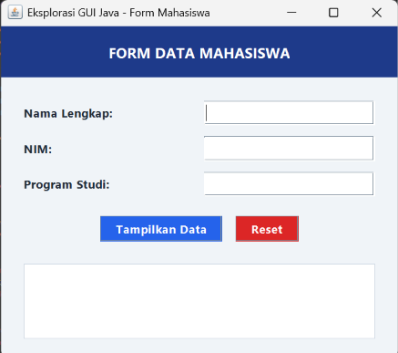
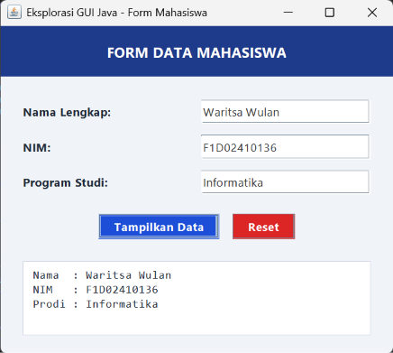

# Tugas-GUI-F1D02410136

# Eksplorasi GUI pada Java (Swing & AWT)

Repositori ini dibuat untuk memenuhi tugas latihan/eksplorasi materi Graphical User Interface (GUI) menggunakan bahasa pemrograman Java.

## 5 Komponen Utama GUI yang Digunakan
1. **Top-level Container Class**
   * `javax.swing.JFrame`: Digunakan sebagai jendela utama aplikasi tempat seluruh panel dan komponen diletakkan.

2. **Intermediate Container Class**
   * `javax.swing.JPanel`: Digunakan sebagai wadah perantara (`panelHeader`, `panelForm`, `panelTombol`, `panelOutput`, dan `panelTengah`) untuk mengelompokkan komponen agar tata letak lebih rapi.

3. **Atomic Component Class**
   * `javax.swing.JLabel`: Menampilkan teks judul dan label keterangan (*Nama Lengkap*, *NIM*, *Program Studi*).
   * `javax.swing.JTextField`: Kolom input teks satu baris untuk pengguna.
   * `javax.swing.JButton`: Tombol interaktif (*Tampilkan Data* dan *Reset*).
   * `javax.swing.JTextArea`: Area teks multi-baris untuk menampilkan hasil input data.

4. **Layout Classes (Minimal 2 Layout)**
   * `java.awt.BorderLayout`: Digunakan pada `JFrame`, `panelOutput`, dan `panelTengah` untuk membagi area atas (`NORTH`), tengah (`CENTER`), dan bawah (`SOUTH`).
   * `java.awt.GridLayout`: Digunakan pada `panelForm` untuk menyusun label dan kolom input dalam bentuk tabel 3 baris x 2 kolom.
   * `java.awt.FlowLayout`: Digunakan pada `panelTombol` untuk menyusun tombol secara sejajar di tengah.

5. **Event Listener (Interface & Adapter)**
   * `java.awt.event.ActionListener`: Meng-override method `actionPerformed(ActionEvent e)` untuk menangani aksi klik pada tombol *Tampilkan Data* dan *Reset*.
   * `java.awt.event.MouseAdapter`: Meng-override method `mouseEntered` dan `mouseExited` untuk memberikan efek perubahan warna saat kursor diarahkan ke tombol.

## Screenshot Hasil Program
### 1. Tampilan Awal

### 2. Tampilan Setelah Input Data

